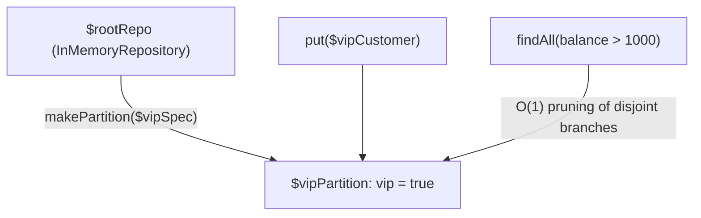

# Directed Acyclic Graph (DAG) Partitioned Repositories

The partition of example 4, drawn: the root repository, the VIP partition made from a specification, the write that lands in it and the query that benefits from the early pruning of disjoint branches.



### 4. Directed Acyclic Graph (DAG) Partitioned Repositories

Partition collections into logical branches indexed by specification predicates:

```php
use Antevemus\ASpecification\Repositories\InMemoryRepository;

$rootRepo = new InMemoryRepository();

// Create an exclusive partition for VIP customers
$vipSpec = Spec::property('vip', Spec::equalTo(true));
$vipPartition = $rootRepo->makePartition($vipSpec);

// Insert into the partitioned repository
// ($vipCustomer implements IEntity, e.g. by extending Entities\AbstractUUIDEntity)
$vipPartition->put($vipCustomer);

// Queries benefit from O(1) early branch pruning of disjoint predicates
$results = $vipPartition->findAll(Spec::property('balance', Spec::greaterThan(1000)));
```
