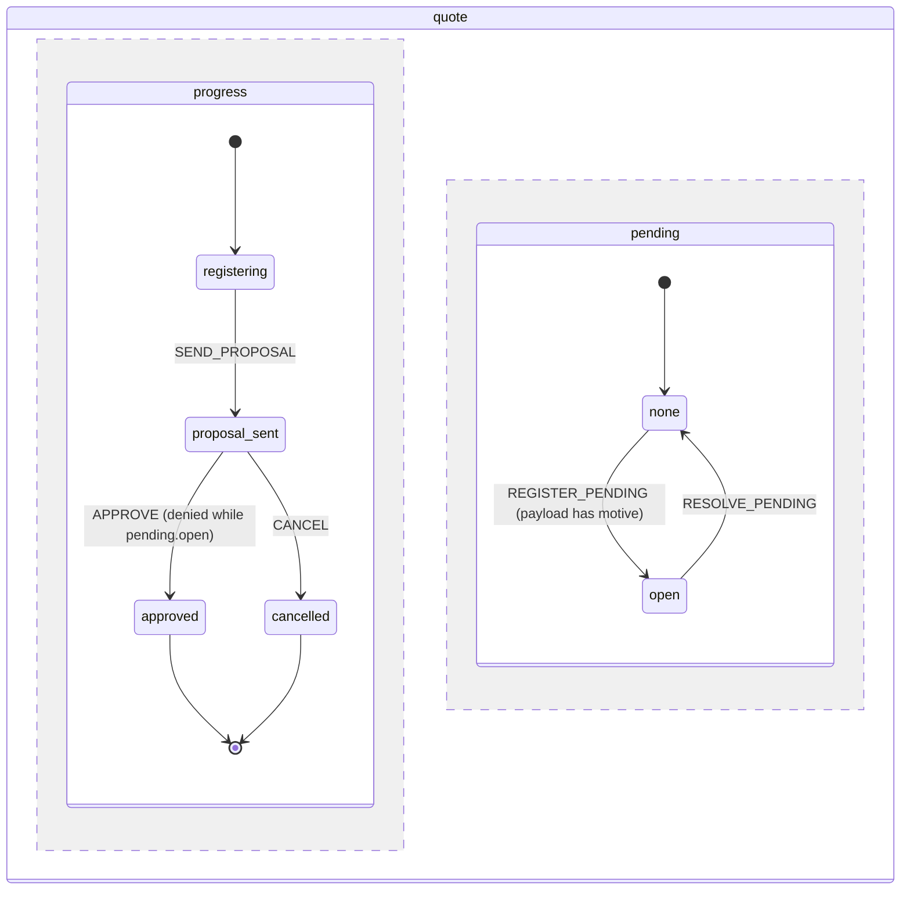

# Spec-Driven State Machine

The `quote` machine of example 14.2, drawn: two parallel regions, `progress` and `pending`. `APPROVE` is denied while the pending item is open; registering or resolving it never moves the progress.



### 14. Spec-Driven State Machine (Modules 17 and 18)

`Antevemus\ASpecification\StateMachine` is a state machine in which **every guard is an `ISpecification`**: when a transition is denied, the result says why, with the code, message, property and severity of the specification that blocked it. The API is event first (`send(event)`, the target is a consequence), the definition is data (stable key and integer version, built fluently or loaded from JSON), `transition()` is pure (it computes the new snapshot, the transitions taken and the effects, and executes nothing), and `MachineRunner` is the single write port (snapshot, history and outbox in one transaction). The snippets of this section build on each other.

#### 14.1 A Minimal Machine: Guards Are Specifications

```php
use Antevemus\ASpecification\Spec;
use Antevemus\ASpecification\StateMachine\Event;

// Named guards: name => factory(array $params): ISpecification, evaluated against a TransitionCandidate
// (context = your domain object or array, event = type + payload + occurredAt, snapshot = current states)
$guards = Spec::guardRegistry()->register('hasRole', fn(array $params) =>
    Spec::property('context.role', Spec::in(...$params['roles']))
        ->because('Only a manager can approve.')
        ->withCode('ROLE_NOT_ALLOWED'));

$order = Spec::machine('purchase_order', 1)
    ->region('lifecycle', 'draft')
        ->state('draft')
            ->on('SUBMIT', 'submitted')
        ->state('submitted')
            ->on('APPROVE', 'approved')->guard('hasRole', ['roles' => ['manager']])
            ->on('SEND_BACK', 'draft')->guard('payloadHas', ['field' => 'motive'])   // built-in guard
        ->finalState('approved')
    ->build();

Spec::validateMachine($order, $guards);              // [] (throws on errors, returns the warnings)

$machine  = Spec::stateMachine($guards);
$now      = new DateTimeImmutable('2026-10-10 09:00'); // the machine never reads the clock
$snapshot = $machine->initialSnapshot($order, null, $now)->getSnapshot();

$result = $machine->transition($order, $snapshot, Event::external('SUBMIT', $now));
$result->isAccepted();                               // true
$snapshot = $result->getSnapshot();
$snapshot->stateOf('lifecycle');                     // 'submitted'

$denied = $machine->transition($order, $snapshot, Event::external('APPROVE', $now), ['role' => 'clerk']);
$denied->isRejected();                               // true: a denial is a result, never an exception
$denied->getSnapshot() === $snapshot;                // true: nothing changed
$denied->getReason()->failures[0]->code;             // 'ROLE_NOT_ALLOWED'
$denied->getReason()->failures[0]->message;          // 'Only a manager can approve.'

$machine->transition($order, $snapshot, Event::external('APPROVE', $now), ['role' => 'manager'])
    ->getSnapshot()->isDone();                       // true: the region is in a final state
```

An event that no transition of the current state answers is `unhandled` (no change, no exception). When several transitions answer the same event, they are tried in declaration order and the first whose guard passes wins; a guard that throws becomes an `ERROR` failure marked `evaluation_error`.

#### 14.2 Parallel Regions: a Pending Flag That Never Loses the Progress

A machine has one or more orthogonal regions, each with its own current state. A pending item modelled as a region of its own (`none ⇄ open`) can be registered and resolved from any step without a "pending" state in the main flow, so resolving it never has to guess where the process was. `inState('region.state')` reads another region, and a guard expression can carry its own message and code:

```php
use Antevemus\ASpecification\StateMachine\GuardExpression;

$quote = Spec::machine('quote', 1)
    ->region('progress', 'registering')
        ->state('registering')
            ->on('SEND_PROPOSAL', 'proposal_sent')
        ->state('proposal_sent')
            ->on('APPROVE', 'approved')
                ->guard(GuardExpression::not(GuardExpression::ref('inState', ['state' => 'pending.open']))
                    ->because('Resolve the open pending item first.')
                    ->withCode('QUOTE_PENDING_OPEN'))
            ->on('CANCEL', 'cancelled')
        ->finalState('approved')
        ->finalState('cancelled')
    ->region('pending', 'none')
        ->state('none')
            ->on('REGISTER_PENDING', 'open')->guard('payloadHas', ['field' => 'motive'])
        ->state('open')
            ->on('RESOLVE_PENDING', 'none')
    ->build();

$machine = Spec::stateMachine();
$state = $machine->initialSnapshot($quote, null, $now)->getSnapshot();
$state = $machine->transition($quote, $state, Event::external('SEND_PROPOSAL', $now))->getSnapshot();
$state = $machine->transition($quote, $state, Event::external('REGISTER_PENDING', $now, ['motive' => 'Missing ID']))->getSnapshot();

$state->stateOf('progress');                         // 'proposal_sent': registering a pending item moved only its region
$state->isIn('pending.open');                        // true
$machine->transition($quote, $state, Event::external('APPROVE', $now))
    ->getReason()->failures[0]->code;                // 'QUOTE_PENDING_OPEN'
$machine->transition($quote, $state, Event::external('CANCEL', $now))->isAccepted(); // true: CANCEL is not blocked

$state = $machine->transition($quote, $state, Event::external('RESOLVE_PENDING', $now))->getSnapshot();
$state->stateOf('progress');                         // 'proposal_sent': back where it was, nothing to remember
$machine->transition($quote, $state, Event::external('APPROVE', $now))->isAccepted(); // true
```

Guards read the snapshot **before** the event (the order of the regions never changes the result), and an event is all or nothing: if any region rejects it, no region moves. The machine is `done` when every region that declares a final state is in one; a region without final states (the pending flag) does not hold the machine open, and a done machine answers every event as `unhandled`.

#### 14.3 `can()` and `nextEvents()`: a Disabled Button With Its Reason

`can()` is `transition()` itself, with no side effect; `nextEvents()` tests every event the current states answer (as an external event with an empty payload), so an action panel can show a disabled button together with the reason. Continuing with the pending item still open:

```php
foreach ($machine->nextEvents($quote, $state, null, $now) as $type => $answer) {
    echo $type, ': ', $answer->isAccepted() ? 'enabled' : 'disabled (' . $answer->getReason()->failures[0]->message . ')', PHP_EOL;
}
// APPROVE: disabled (Resolve the open pending item first.)
// CANCEL: enabled
// RESOLVE_PENDING: enabled

$machine->can($quote, $state, Event::external('APPROVE', $now))
    ->getRejections()['progress']->failures[0]->code; // 'QUOTE_PENDING_OPEN' (the reason per rejecting region)
```

#### 14.4 The Definition Is Data: JSON and the Validator

Guards and actions are referenced by name and parameters, never by closures, so a definition round-trips through arrays and JSON without loss and has a deterministic fingerprint (SHA-256 of its canonical form) to detect a definition changed without a new version. The validator runs at load time: it refuses the definition (one exception listing every error) for a region without initial state, an unknown target or `inState` path, a guard without factory (or an action without handler, when the known action names are given), a final state with outgoing transitions; it warns, without blocking, about unreachable states, non-final states without exit, overlapping or shadowed guards and guards that always pass. The document requirement below (pending → delivered → validated, or expired after 30 days) is the `RequirementState` the 1.0.0 changelog announced, now expressed as a machine:

```php
use Antevemus\ASpecification\StateMachine\MachineDefinition;

$requirement = MachineDefinition::fromJson(<<<'JSON'
{
  "key": "document_requirement",
  "version": 1,
  "regions": [{
    "name": "lifecycle",
    "initial": "pending",
    "states": [
      {"name": "pending", "transitions": [
        {"event": "DELIVER", "target": "delivered", "guard": {"guard": "payloadHas", "params": {"field": "file"}}}
      ]},
      {"name": "delivered", "deadline": {"after": "P30D", "event": "EXPIRE"}, "transitions": [
        {"event": "VALIDATE", "target": "validated"},
        {"event": "EXPIRE", "target": "expired"}
      ]},
      {"name": "on_hold"},
      {"name": "validated", "final": true},
      {"name": "expired", "final": true}
    ]
  }]
}
JSON);

MachineDefinition::fromArray($requirement->toArray()) == $requirement;   // true: lossless round trip
$requirement->fingerprint();                         // 64 hex characters, stable across key order and runs
$requirement->getTransition('lifecycle.pending.DELIVER') !== null;       // true: ids are generated as region.state.EVENT

foreach (Spec::validateMachine($requirement) as $warning) {
    echo $warning->kind, ': ', $warning->state, PHP_EOL;
}
// unreachable_state: on_hold
// dead_end_state: on_hold
```

#### 14.5 The Runner: One Transaction, Idempotency, Outbox and Persisted Deadlines

`MachineRunner::send()` loads the instance and the definition version it was started with, checks the idempotency key, computes the transition, and writes the new snapshot (compare-and-set on its version: a concurrent change throws `ConcurrencyConflictException` and is never retried silently), one history row per region moved and the effects in the outbox, in **one** transaction. Effects (the named actions: `exit` → transition → `entry`) are delivered **after** the commit by an `EffectDispatcher`, each with its own idempotency key, in write order per instance; a failing handler never undoes the transition. A deadline is persisted (`due_at`), never a timer in memory: a cron asks for the due ones and delivers them through the same runner, and a late or repeated delivery is harmless.

```php
use Antevemus\ASpecification\StateMachine\Effect;
use Antevemus\ASpecification\StateMachine\Persistence\InMemory\InMemoryMachineDefinitionRepository;
use Antevemus\ASpecification\StateMachine\Persistence\MachinePersistence;
use Antevemus\ASpecification\StateMachine\Runner\EffectDispatcher;
use Antevemus\ASpecification\StateMachine\Runner\EffectHandlerRegistry;
use Antevemus\ASpecification\StateMachine\Runner\MachineRunner;

$document = Spec::machine('document', 1)
    ->region('lifecycle', 'pending')
        ->state('pending')
            ->on('DELIVER', 'delivered')->guard('payloadHas', ['field' => 'file'])->action('notify_reviewer')
        ->state('delivered')->deadline('P3D', 'EXPIRE')
            ->on('VALIDATE', 'validated')
            ->on('EXPIRE', 'expired')->action('notify_owner')
        ->finalState('validated')
        ->finalState('expired')
    ->build();

$sent = [];
$handlers = (new EffectHandlerRegistry())
    ->register('notify_reviewer', function (Effect $effect, string $idempotencyKey) use (&$sent): void { $sent[] = $effect->action; })
    ->register('notify_owner', function (Effect $effect, string $idempotencyKey) use (&$sent): void { $sent[] = $effect->action; });

$persistence = MachinePersistence::inMemory();
$runner = new MachineRunner(Spec::stateMachine(), new InMemoryMachineDefinitionRepository([$document]), $persistence, $handlers);
$runner->start('doc-42', 'document', 1, null, new DateTimeImmutable('2026-10-10 09:00'));

$deliver = Event::external('DELIVER', new DateTimeImmutable('2026-10-10 10:00'), ['file' => 'id.pdf'], 'upload-7f3a');
$runner->send('doc-42', $deliver, actor: 'alice')->isAccepted();  // true
$runner->send('doc-42', $deliver, actor: 'alice')->isAccepted();  // true: same key, the original result, nothing written twice
$runner->load('doc-42')->version;                                 // 2 (start + one accepted event)
count($persistence->history->findByInstance('doc-42'));           // 2 (append-only: start + DELIVER)

// After the commit (a worker or a cron): deliver the effects
(new EffectDispatcher($persistence->outbox, $handlers))->dispatchPending()->deliveredCount(); // 1
$sent;                                                            // ['notify_reviewer']

// Deadlines: find and deliver the due ones (the EXPIRE event is internal: it cannot be sent from outside)
$runner->findDue(new DateTimeImmutable('2026-10-12 10:00'));       // [] (due at 2026-10-13 10:00)
$deliveries = $runner->deliverDue(new DateTimeImmutable('2026-10-13 10:00'), actor: 'scheduler');
$deliveries[0]->isDelivered();                                    // true
$runner->load('doc-42')->snapshot->stateOf('lifecycle');          // 'expired'
```

`EffectHandlerRegistry::registerSync()` declares the rare effect that must be able to veto: it runs inside the transaction, before the commit, and an exception rolls the whole step back. Each instance stays pinned to the definition version it started with; moving it to a new version is explicit (`registerMigration()` + `migrate()`).

#### 14.6 PDO Persistence and the Reference DDL

`MachinePersistence::pdo()` gives the same ports over the tables of [`resources/sql/state_machine.ansi.sql`](https://github.com/antevemus-it/Antevemus.ASpecification/blob/main/resources/sql/state_machine.ansi.sql): portable SQL, `CREATE TABLE IF NOT EXISTS` (accepted by PostgreSQL, MySQL/MariaDB and SQLite), a primary key on every table, `UNIQUE (instance_id, idempotency_key)`, instants as fixed-width UTC text. The due deadlines are searched with a specification compiled to SQL by the SQL visitor. The InMemory and PDO stores run the same test battery (SQLite in memory in the suite).

```php
// Once, with your migration tool: resources/sql/state_machine.ansi.sql
$runner = new MachineRunner(
    Spec::stateMachine(),
    new InMemoryMachineDefinitionRepository([$document]),  // definitions ship with the application
    MachinePersistence::pdo($pdo),                         // same contract as inMemory()
    $handlers
);

// Tables with other names: table names by role (instance, region, history, outbox, idempotency,
// rejection), an optional schema and, when the columns differ, canonical column => real column
$persistence = MachinePersistence::pdo($pdo, tables: ['instance' => 'quote_state', 'history' => 'quote_state_history']);
```

> [!NOTE]
> **JSON columns.** `snapshot`, `payload`, `params`, `reason` and `transition_result` are JSON stored as `VARCHAR(4000)`, the portable size that also fits Oracle. A larger event payload needs the column widened to `TEXT`/`JSONB`/`CLOB` in your copy of the DDL. If the PDO connection is already inside a transaction, the runner joins it and the owner of that transaction commits or rolls back.

> [!NOTE]
> **Upgrading from 1.8.** Since 1.9.0 `state_machine_region` has a nullable `paused_remaining` column (the balance of a paused deadline, example 14.7). `CREATE TABLE IF NOT EXISTS` does not add a column to an existing table, so a database created with the 1.8 script needs, once, before the first deadline pause: `ALTER TABLE state_machine_region ADD COLUMN paused_remaining INTEGER;`. Until then, every definition that never pauses a deadline keeps working on the old table; the first pause fails and its step is rolled back.

#### 14.7 Deadlines From the Context: an SLA That Pauses While a Pending Item Is Open

A deadline has exactly one source: a fixed duration (`deadline('P3D', 'EXPIRE')`, as in 14.5), a duration read from the context (`afterFrom: 'context.path'`, an ISO-8601 string or a `DateInterval`), or the due instant itself read from the context (`atFrom: 'context.path'`, a `DateTimeInterface` or an ISO-8601 text with date, time and offset). The path is read with the dot notation of the `PropertyAccessor` when the state is entered, from the context given to that call, so the computation stays pure. A missing or invalid source never becomes a silently empty deadline: the event that enters the state is rejected with `SM_DEADLINE_SOURCE_INVALID` (an `ERROR` that names the path, never the value), and so is a start, which then writes nothing. `pausedWhile` takes a guard expression (a `'region.state'` string is a shorthand for `inState`), evaluated after every accepted step: when it starts to hold, the deadline pauses (no due instant, so no cron ever finds it, and the remaining whole seconds are kept); when it stops holding, the deadline resumes from that balance. Re-entering the state restarts the deadline and drops the balance. Below, the SLA is a region of its own (an absolute instant from the contract), paused while a pending flag (the parallel region of example 14.2) is open, and each stage lasts what the client's table says:

```php
use Antevemus\ASpecification\StateMachine\Persistence\DueDeadline;
use Antevemus\ASpecification\StateMachine\Persistence\MachineInstance;

$claim = Spec::machine('claim', 1)
    ->region('progress', 'triage')
        ->state('triage')->deadline(event: 'TRIAGE_CLOSED', afterFrom: 'context.deadlines.triage')
            ->on('START_ANALYSIS', 'analysis')
            ->on('TRIAGE_CLOSED', 'analysis')
        ->state('analysis')->deadline(event: 'ANALYSIS_OVERDUE', afterFrom: 'context.deadlines.analysis')
            ->on('APPROVE', 'approved')
            ->on('ANALYSIS_OVERDUE', 'late')
        ->state('late')
            ->on('APPROVE', 'approved')
        ->finalState('approved')
    ->region('pending', 'none')
        ->state('none')->on('REGISTER_PENDING', 'open')
        ->state('open')->on('RESOLVE_PENDING', 'none')
    ->region('sla', 'running')
        ->state('running')->deadline(event: 'SLA_BREACHED', atFrom: 'context.sla_due_at', pausedWhile: 'pending.open')
            ->on('SLA_BREACHED', 'breached')
        ->finalState('breached')
    ->build();

// The context of each claim: the SLA instant of the contract and the stage durations of the client
$contexts = ['claim-7' => ['sla_due_at' => '2026-11-09T18:00:00-03:00', 'deadlines' => ['triage' => 'P2D', 'analysis' => 'P5D']]];

$runner = new MachineRunner(Spec::stateMachine(), new InMemoryMachineDefinitionRepository([$claim]), MachinePersistence::inMemory());
$runner->start('claim-7', 'claim', 1, $contexts['claim-7'], new DateTimeImmutable('2026-10-10T09:00:00-03:00'))->isAccepted(); // true
$runner->load('claim-7')->snapshot->dueAt('sla')->format(DATE_ATOM);      // '2026-11-09T18:00:00-03:00' (atFrom)
$runner->load('claim-7')->snapshot->dueAt('progress')->format(DATE_ATOM); // '2026-10-12T09:00:00-03:00' (start + P2D, afterFrom)

// A missing source is a rejection, never a silently empty SLA: the start writes nothing
$missing = $runner->start('claim-8', 'claim', 1, ['deadlines' => ['triage' => 'P2D']], new DateTimeImmutable('2026-10-10T09:00:00-03:00'));
$missing->isRejected();                                                   // true
$missing->getReason()->failures[0]->code;                                 // 'SM_DEADLINE_SOURCE_INVALID'
$missing->getReason()->failures[0]->property;                             // 'context.sla_due_at'

// The cron: TRIAGE_CLOSED enters 'analysis', whose deadline reads the context, so the cron provides it
$deliveries = $runner->deliverDue(
    new DateTimeImmutable('2026-10-12T09:00:00-03:00'),
    contextProvider: fn(DueDeadline $due, MachineInstance $instance) => $contexts[$instance->instanceId]
);
$deliveries[0]->isDelivered();                                            // true (without the provider: rejected, retried on the next run)
$runner->load('claim-7')->snapshot->dueAt('progress')->format(DATE_ATOM); // '2026-10-17T09:00:00-03:00'

// A pending item opened 20 days before the SLA: the SLA pauses and keeps the balance
$runner->send('claim-7', Event::external('REGISTER_PENDING', new DateTimeImmutable('2026-10-20T18:00:00-03:00')), $contexts['claim-7']);
$snapshot = $runner->load('claim-7')->snapshot;
$snapshot->isPaused('sla');                                               // true
$snapshot->dueAt('sla');                                                  // null: a paused deadline is never due
$snapshot->pausedRemaining('sla');                                        // 1728000 (20 days, in whole seconds)
array_map(fn(DueDeadline $due) => $due->region, $runner->findDue(new DateTimeImmutable('2027-01-01T00:00:00-03:00'))); // ['progress']

// Resolved 5 days later: the SLA resumes with the balance, 5 days after the contract instant
$runner->send('claim-7', Event::external('RESOLVE_PENDING', new DateTimeImmutable('2026-10-25T18:00:00-03:00')), $contexts['claim-7']);
$runner->load('claim-7')->snapshot->dueAt('sla')->format(DATE_ATOM);      // '2026-11-14T18:00:00-03:00'
```

`deliverDue()` sends a null context unless given a `contextProvider` (it receives the due deadline and the loaded instance): a deadline transition entering a state whose deadline reads the context needs the instance's context, as here. A pause condition is any guard expression; one that throws rejects the step. The validator refuses a `pausedWhile` with an unknown guard or an `inState` path that does not exist, and warns when it references the deadline's own region (the pause would never end). The snapshot keeps the balance (`pausedRemaining()`, `paused_remaining` in its array form only while some region is paused, so a 1.8 snapshot loads unchanged), and `migrate()` refuses a migration that would leave a paused balance in a state whose deadline declares no `pausedWhile`, since it could never resume.

Deliberately out of scope (each can be modelled without it): actors, `invoke`/`spawn` (asynchronous work is an external job that sends an event back), eventless (`always`) transitions and `raise` (the caller sends the next event), nested states inside a region and history states (a parallel region, like the pending flag above, covers the real cases), and a machine-owned context (`assign`): the context is the caller's domain object. The history is a trail; the snapshot is the source of truth (no event sourcing).
