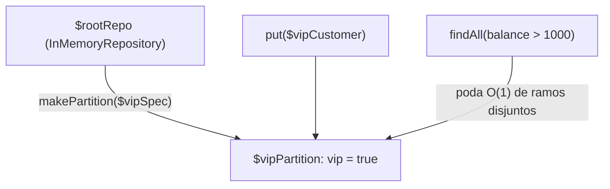

# Repositórios Particionados em Grafo (DAG)

A partição do exemplo 4, desenhada: o repositório raiz, a partição VIP criada a partir de uma especificação, a escrita que cai nela e a consulta que se beneficia da poda antecipada de ramos disjuntos.



### 4. Repositórios Particionados em Grafo (DAG)

Crie repositórios que subdividem coleções em partições lógicas indexadas por especificações:

```php
use Antevemus\ASpecification\Repositories\InMemoryRepository;

$rootRepo = new InMemoryRepository();

// Cria uma partição exclusiva para clientes VIP
$vipSpec = Spec::property('vip', Spec::equalTo(true));
$vipPartition = $rootRepo->makePartition($vipSpec);

// Inserções e consultas no repositório particionado
// ($vipCustomer implementa IEntity, por exemplo estendendo Entities\AbstractUUIDEntity)
$vipPartition->put($vipCustomer);

// Consultas aproveitam descarte O(1) de ramos disjuntos
$results = $vipPartition->findAll(Spec::property('balance', Spec::greaterThan(1000)));
```
