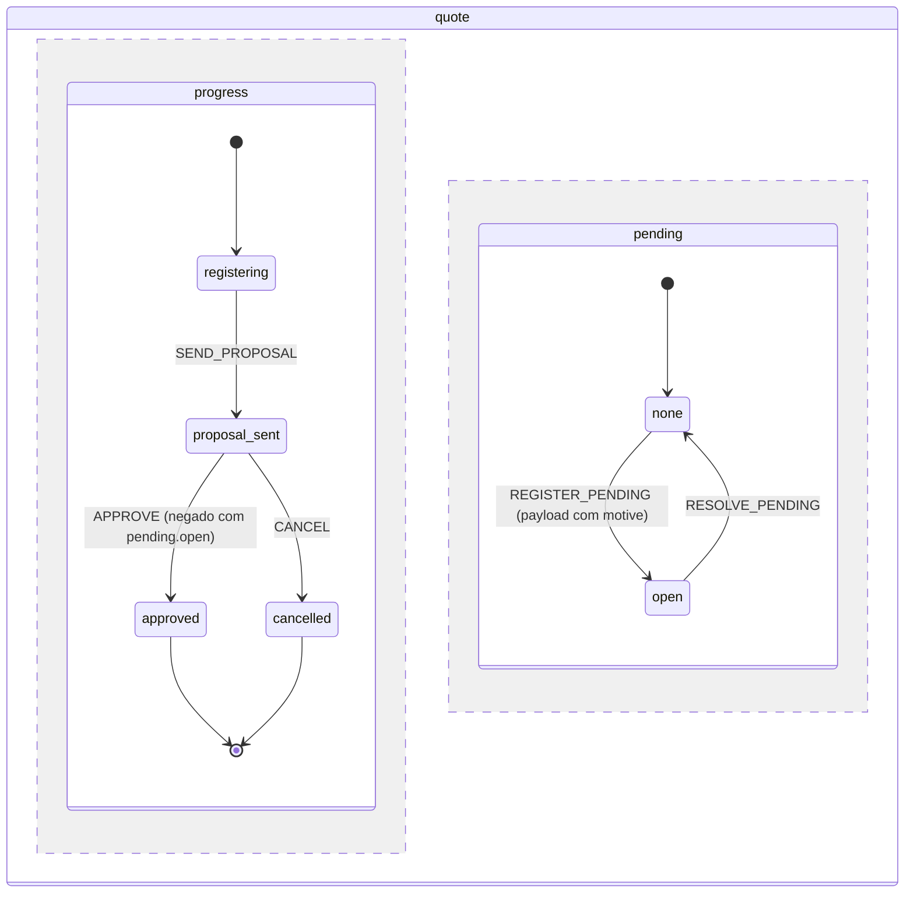

# Máquina de Estados Dirigida por Especificações

A máquina `quote` do exemplo 14.2, desenhada: duas regiões paralelas, `progress` e `pending`. O `APPROVE` é negado enquanto a pendência está aberta; registrar ou resolver a pendência nunca move o andamento.



### 14. Máquina de Estados Dirigida por Especificações (Módulos 17 e 18)

`Antevemus\ASpecification\StateMachine` é uma máquina de estados em que **todo guard é uma `ISpecification`**: quando uma transição é negada, o resultado diz por quê, com o código, a mensagem, a propriedade e a severidade da especificação que barrou. A API é dirigida por evento (`send(evento)`, o alvo é consequência), a definição é dado (chave estável e versão inteira, montada por builder fluente ou carregada de JSON), `transition()` é puro (calcula o snapshot novo, as transições tomadas e os efeitos, e não executa nada) e o `MachineRunner` é a única porta de escrita (snapshot, histórico e outbox numa transação). Os trechos desta seção se apoiam uns nos outros.

#### 14.1 Máquina Mínima: Guards São Especificações

```php
use Antevemus\ASpecification\Spec;
use Antevemus\ASpecification\StateMachine\Event;

// Guards nomeados: nome => fábrica(array $params): ISpecification, avaliada contra um TransitionCandidate
// (context = seu objeto de domínio ou array, event = tipo + payload + occurredAt, snapshot = estados atuais)
$guards = Spec::guardRegistry()->register('hasRole', fn(array $params) =>
    Spec::property('context.role', Spec::in(...$params['roles']))
        ->because('Only a manager can approve.')
        ->withCode('ROLE_NOT_ALLOWED'));

$order = Spec::machine('purchase_order', 1)
    ->region('lifecycle', 'draft')
        ->state('draft')
            ->on('SUBMIT', 'submitted')
        ->state('submitted')
            ->on('APPROVE', 'approved')->guard('hasRole', ['roles' => ['manager']])
            ->on('SEND_BACK', 'draft')->guard('payloadHas', ['field' => 'motive'])   // guard embutido
        ->finalState('approved')
    ->build();

Spec::validateMachine($order, $guards);              // [] (lança nos erros, devolve os avisos)

$machine  = Spec::stateMachine($guards);
$now      = new DateTimeImmutable('2026-10-10 09:00'); // a máquina nunca lê o relógio
$snapshot = $machine->initialSnapshot($order, null, $now)->getSnapshot();

$result = $machine->transition($order, $snapshot, Event::external('SUBMIT', $now));
$result->isAccepted();                               // true
$snapshot = $result->getSnapshot();
$snapshot->stateOf('lifecycle');                     // 'submitted'

$denied = $machine->transition($order, $snapshot, Event::external('APPROVE', $now), ['role' => 'clerk']);
$denied->isRejected();                               // true: negação é resultado, nunca exceção
$denied->getSnapshot() === $snapshot;                // true: nada mudou
$denied->getReason()->failures[0]->code;             // 'ROLE_NOT_ALLOWED'
$denied->getReason()->failures[0]->message;          // 'Only a manager can approve.'

$machine->transition($order, $snapshot, Event::external('APPROVE', $now), ['role' => 'manager'])
    ->getSnapshot()->isDone();                       // true: a região está num estado final
```

Evento que nenhuma transição do estado atual atende é `unhandled` (sem mudança e sem exceção). Quando várias transições atendem o mesmo evento, são testadas na ordem declarada e vence a primeira cujo guard passa; guard que lança vira falha `ERROR` marcada `evaluation_error`.

#### 14.2 Regiões Paralelas: Pendência Que Nunca Perde o Andamento

A máquina tem uma ou mais regiões ortogonais, cada uma com seu estado atual. A pendência modelada como região própria (`none ⇄ open`) pode ser registrada e resolvida em qualquer etapa sem um estado "pendente" no fluxo principal, então resolvê-la nunca precisa adivinhar onde o processo estava. `inState('região.estado')` lê outra região, e uma expressão de guard pode trazer a própria mensagem e o próprio código:

```php
use Antevemus\ASpecification\StateMachine\GuardExpression;

$quote = Spec::machine('quote', 1)
    ->region('progress', 'registering')
        ->state('registering')
            ->on('SEND_PROPOSAL', 'proposal_sent')
        ->state('proposal_sent')
            ->on('APPROVE', 'approved')
                ->guard(GuardExpression::not(GuardExpression::ref('inState', ['state' => 'pending.open']))
                    ->because('Resolve the open pending item first.')
                    ->withCode('QUOTE_PENDING_OPEN'))
            ->on('CANCEL', 'cancelled')
        ->finalState('approved')
        ->finalState('cancelled')
    ->region('pending', 'none')
        ->state('none')
            ->on('REGISTER_PENDING', 'open')->guard('payloadHas', ['field' => 'motive'])
        ->state('open')
            ->on('RESOLVE_PENDING', 'none')
    ->build();

$machine = Spec::stateMachine();
$state = $machine->initialSnapshot($quote, null, $now)->getSnapshot();
$state = $machine->transition($quote, $state, Event::external('SEND_PROPOSAL', $now))->getSnapshot();
$state = $machine->transition($quote, $state, Event::external('REGISTER_PENDING', $now, ['motive' => 'Missing ID']))->getSnapshot();

$state->stateOf('progress');                         // 'proposal_sent': registrar a pendência só moveu a região dela
$state->isIn('pending.open');                        // true
$machine->transition($quote, $state, Event::external('APPROVE', $now))
    ->getReason()->failures[0]->code;                // 'QUOTE_PENDING_OPEN'
$machine->transition($quote, $state, Event::external('CANCEL', $now))->isAccepted(); // true: CANCEL não é barrado

$state = $machine->transition($quote, $state, Event::external('RESOLVE_PENDING', $now))->getSnapshot();
$state->stateOf('progress');                         // 'proposal_sent': de volta onde estava, nada a lembrar
$machine->transition($quote, $state, Event::external('APPROVE', $now))->isAccepted(); // true
```

Os guards leem o snapshot **anterior** ao evento (a ordem das regiões nunca muda o resultado), e o evento é tudo ou nada: se alguma região o rejeita, nenhuma se move. A máquina fica `done` quando toda região que declara estado final está num deles; região sem estado final (a pendência) não segura a máquina aberta, e máquina `done` responde `unhandled` a todo evento.

#### 14.3 `can()` e `nextEvents()`: Botão Desabilitado Com o Motivo

`can()` é o próprio `transition()`, sem efeito colateral; `nextEvents()` testa cada evento que os estados atuais atendem (como evento externo com payload vazio), para o painel de ações mostrar o botão desabilitado junto com o motivo. Continuando com a pendência ainda aberta:

```php
foreach ($machine->nextEvents($quote, $state, null, $now) as $type => $answer) {
    echo $type, ': ', $answer->isAccepted() ? 'enabled' : 'disabled (' . $answer->getReason()->failures[0]->message . ')', PHP_EOL;
}
// APPROVE: disabled (Resolve the open pending item first.)
// CANCEL: enabled
// RESOLVE_PENDING: enabled

$machine->can($quote, $state, Event::external('APPROVE', $now))
    ->getRejections()['progress']->failures[0]->code; // 'QUOTE_PENDING_OPEN' (o motivo por região que rejeitou)
```

#### 14.4 A Definição É Dado: JSON e o Validador

Guards e ações são referenciados por nome e parâmetros, nunca por closures, então a definição faz ida e volta por array e JSON sem perda e tem fingerprint determinístico (SHA-256 da forma canônica) para detectar definição alterada sem troca de versão. O validador roda na carga: recusa a definição (uma exceção com a lista de todos os erros) por região sem estado inicial, alvo ou caminho de `inState` inexistente, guard sem fábrica (ou ação sem handler, quando os nomes de ação conhecidos são informados), estado final com transição de saída; avisa, sem bloquear, sobre estados inalcançáveis, estados não finais sem saída, guards sobrepostos ou encobertos e guards que sempre passam. O requisito documental abaixo (pendente → entregue → validado, ou vencido após 30 dias) é o `RequirementState` que o changelog da 1.0.0 anunciou, agora expresso como máquina:

```php
use Antevemus\ASpecification\StateMachine\MachineDefinition;

$requirement = MachineDefinition::fromJson(<<<'JSON'
{
  "key": "document_requirement",
  "version": 1,
  "regions": [{
    "name": "lifecycle",
    "initial": "pending",
    "states": [
      {"name": "pending", "transitions": [
        {"event": "DELIVER", "target": "delivered", "guard": {"guard": "payloadHas", "params": {"field": "file"}}}
      ]},
      {"name": "delivered", "deadline": {"after": "P30D", "event": "EXPIRE"}, "transitions": [
        {"event": "VALIDATE", "target": "validated"},
        {"event": "EXPIRE", "target": "expired"}
      ]},
      {"name": "on_hold"},
      {"name": "validated", "final": true},
      {"name": "expired", "final": true}
    ]
  }]
}
JSON);

MachineDefinition::fromArray($requirement->toArray()) == $requirement;   // true: ida e volta sem perda
$requirement->fingerprint();                         // 64 caracteres hexadecimais, estável entre execuções e ordem de chaves
$requirement->getTransition('lifecycle.pending.DELIVER') !== null;       // true: ids gerados como região.estado.EVENTO

foreach (Spec::validateMachine($requirement) as $warning) {
    echo $warning->kind, ': ', $warning->state, PHP_EOL;
}
// unreachable_state: on_hold
// dead_end_state: on_hold
```

#### 14.5 O Runner: Uma Transação, Idempotência, Outbox e Prazos Persistidos

`MachineRunner::send()` carrega a instância e a versão da definição em que ela nasceu, confere a chave de idempotência, calcula a transição e grava o snapshot novo (compare-and-set pela versão: mudança concorrente lança `ConcurrencyConflictException` e nunca é repetida em silêncio), uma linha de histórico por região movida e os efeitos na outbox, em **uma** transação. Os efeitos (as ações nomeadas: `exit` → transição → `entry`) são entregues **depois** do commit por um `EffectDispatcher`, cada um com sua chave de idempotência, na ordem de gravação por instância; handler que falha nunca desfaz a transição. Prazo é persistido (`due_at`), nunca timer em memória: um cron pede os vencidos e os entrega pelo mesmo runner, e entrega atrasada ou repetida é inofensiva.

```php
use Antevemus\ASpecification\StateMachine\Effect;
use Antevemus\ASpecification\StateMachine\Persistence\InMemory\InMemoryMachineDefinitionRepository;
use Antevemus\ASpecification\StateMachine\Persistence\MachinePersistence;
use Antevemus\ASpecification\StateMachine\Runner\EffectDispatcher;
use Antevemus\ASpecification\StateMachine\Runner\EffectHandlerRegistry;
use Antevemus\ASpecification\StateMachine\Runner\MachineRunner;

$document = Spec::machine('document', 1)
    ->region('lifecycle', 'pending')
        ->state('pending')
            ->on('DELIVER', 'delivered')->guard('payloadHas', ['field' => 'file'])->action('notify_reviewer')
        ->state('delivered')->deadline('P3D', 'EXPIRE')
            ->on('VALIDATE', 'validated')
            ->on('EXPIRE', 'expired')->action('notify_owner')
        ->finalState('validated')
        ->finalState('expired')
    ->build();

$sent = [];
$handlers = (new EffectHandlerRegistry())
    ->register('notify_reviewer', function (Effect $effect, string $idempotencyKey) use (&$sent): void { $sent[] = $effect->action; })
    ->register('notify_owner', function (Effect $effect, string $idempotencyKey) use (&$sent): void { $sent[] = $effect->action; });

$persistence = MachinePersistence::inMemory();
$runner = new MachineRunner(Spec::stateMachine(), new InMemoryMachineDefinitionRepository([$document]), $persistence, $handlers);
$runner->start('doc-42', 'document', 1, null, new DateTimeImmutable('2026-10-10 09:00'));

$deliver = Event::external('DELIVER', new DateTimeImmutable('2026-10-10 10:00'), ['file' => 'id.pdf'], 'upload-7f3a');
$runner->send('doc-42', $deliver, actor: 'alice')->isAccepted();  // true
$runner->send('doc-42', $deliver, actor: 'alice')->isAccepted();  // true: mesma chave, o resultado original, nada gravado duas vezes
$runner->load('doc-42')->version;                                 // 2 (start + um evento aceito)
count($persistence->history->findByInstance('doc-42'));           // 2 (append-only: start + DELIVER)

// Depois do commit (um worker ou um cron): entrega os efeitos
(new EffectDispatcher($persistence->outbox, $handlers))->dispatchPending()->deliveredCount(); // 1
$sent;                                                            // ['notify_reviewer']

// Prazos: acha e entrega os vencidos (o evento EXPIRE é interno: não pode ser enviado de fora)
$runner->findDue(new DateTimeImmutable('2026-10-12 10:00'));       // [] (vence em 2026-10-13 10:00)
$deliveries = $runner->deliverDue(new DateTimeImmutable('2026-10-13 10:00'), actor: 'scheduler');
$deliveries[0]->isDelivered();                                    // true
$runner->load('doc-42')->snapshot->stateOf('lifecycle');          // 'expired'
```

`EffectHandlerRegistry::registerSync()` declara o efeito raro que precisa poder vetar: roda dentro da transação, antes do commit, e uma exceção desfaz o passo inteiro. Cada instância fica presa à versão da definição em que nasceu; levá-la a uma versão nova é explícito (`registerMigration()` + `migrate()`).

#### 14.6 Persistência em PDO e o DDL de Referência

`MachinePersistence::pdo()` dá as mesmas portas sobre as tabelas de [`resources/sql/state_machine.ansi.sql`](https://github.com/antevemus-it/Antevemus.ASpecification/blob/main/resources/sql/state_machine.ansi.sql): SQL portável, `CREATE TABLE IF NOT EXISTS` (aceito por PostgreSQL, MySQL/MariaDB e SQLite), chave primária em toda tabela, `UNIQUE (instance_id, idempotency_key)`, instantes como texto UTC de largura fixa. Os prazos vencidos são buscados por uma especificação compilada para SQL pelo SQL visitor. Os stores InMemory e PDO rodam a mesma bateria de testes (SQLite em memória na suíte).

```php
// Uma vez, com sua ferramenta de migração: resources/sql/state_machine.ansi.sql
$runner = new MachineRunner(
    Spec::stateMachine(),
    new InMemoryMachineDefinitionRepository([$document]),  // as definições vão junto com a aplicação
    MachinePersistence::pdo($pdo),                         // mesmo contrato do inMemory()
    $handlers
);

// Tabelas com outros nomes: nome por papel (instance, region, history, outbox, idempotency,
// rejection), um schema opcional e, quando as colunas diferem, coluna canônica => coluna real
$persistence = MachinePersistence::pdo($pdo, tables: ['instance' => 'quote_state', 'history' => 'quote_state_history']);
```

> [!NOTE]
> **Colunas JSON.** `snapshot`, `payload`, `params`, `reason` e `transition_result` são JSON guardado em `VARCHAR(4000)`, o tamanho portável que cabe também no Oracle. Payload de evento maior exige alargar a coluna para `TEXT`/`JSONB`/`CLOB` na sua cópia do DDL. Se a conexão PDO já estiver numa transação, o runner entra nela e quem a abriu faz o commit ou o rollback.

> [!NOTE]
> **Atualizando da 1.8.** Desde a 1.9.0 a `state_machine_region` tem a coluna anulável `paused_remaining` (o saldo de um prazo pausado, exemplo 14.7). `CREATE TABLE IF NOT EXISTS` não acrescenta coluna a uma tabela que já existe, então um banco criado com o script da 1.8 precisa, uma vez, antes da primeira pausa de prazo: `ALTER TABLE state_machine_region ADD COLUMN paused_remaining INTEGER;`. Até lá, toda definição que nunca pausa um prazo continua funcionando na tabela antiga; a primeira pausa falha e o passo dela é desfeito.

#### 14.7 Prazos Vindos do Contexto: um SLA Que Pausa Enquanto Há Pendência Aberta

Um prazo tem exatamente uma fonte: uma duração fixa (`deadline('P3D', 'EXPIRE')`, como em 14.5), uma duração lida do contexto (`afterFrom: 'context.caminho'`, texto ISO-8601 ou `DateInterval`) ou o próprio instante de vencimento lido do contexto (`atFrom: 'context.caminho'`, `DateTimeInterface` ou texto ISO-8601 com data, hora e offset). O caminho é lido com a notação de ponto do `PropertyAccessor` na entrada do estado, a partir do contexto passado a essa chamada, então o cálculo continua puro. Fonte ausente ou inválida nunca vira prazo silenciosamente vazio: o evento que entra no estado é rejeitado com `SM_DEADLINE_SOURCE_INVALID` (um `ERROR` que cita o caminho, nunca o valor), e o início também, que então não grava nada. `pausedWhile` recebe uma expressão de guard (um texto `'região.estado'` é atalho de `inState`), avaliada depois de cada passo aceito: quando passa a valer, o prazo pausa (sem instante de vencimento, então nenhum cron o encontra, e os segundos inteiros restantes ficam guardados); quando deixa de valer, o prazo retoma a partir desse saldo. Reentrar no estado reinicia o prazo e descarta o saldo. Abaixo, o SLA é uma região própria (um instante absoluto do contrato), pausado enquanto uma pendência (a região paralela do exemplo 14.2) está aberta, e cada etapa dura o que a tabela do cliente diz:

```php
use Antevemus\ASpecification\StateMachine\Persistence\DueDeadline;
use Antevemus\ASpecification\StateMachine\Persistence\MachineInstance;

$claim = Spec::machine('claim', 1)
    ->region('progress', 'triage')
        ->state('triage')->deadline(event: 'TRIAGE_CLOSED', afterFrom: 'context.deadlines.triage')
            ->on('START_ANALYSIS', 'analysis')
            ->on('TRIAGE_CLOSED', 'analysis')
        ->state('analysis')->deadline(event: 'ANALYSIS_OVERDUE', afterFrom: 'context.deadlines.analysis')
            ->on('APPROVE', 'approved')
            ->on('ANALYSIS_OVERDUE', 'late')
        ->state('late')
            ->on('APPROVE', 'approved')
        ->finalState('approved')
    ->region('pending', 'none')
        ->state('none')->on('REGISTER_PENDING', 'open')
        ->state('open')->on('RESOLVE_PENDING', 'none')
    ->region('sla', 'running')
        ->state('running')->deadline(event: 'SLA_BREACHED', atFrom: 'context.sla_due_at', pausedWhile: 'pending.open')
            ->on('SLA_BREACHED', 'breached')
        ->finalState('breached')
    ->build();

// O contexto de cada sinistro: o instante do SLA do contrato e as durações de etapa do cliente
$contexts = ['claim-7' => ['sla_due_at' => '2026-11-09T18:00:00-03:00', 'deadlines' => ['triage' => 'P2D', 'analysis' => 'P5D']]];

$runner = new MachineRunner(Spec::stateMachine(), new InMemoryMachineDefinitionRepository([$claim]), MachinePersistence::inMemory());
$runner->start('claim-7', 'claim', 1, $contexts['claim-7'], new DateTimeImmutable('2026-10-10T09:00:00-03:00'))->isAccepted(); // true
$runner->load('claim-7')->snapshot->dueAt('sla')->format(DATE_ATOM);      // '2026-11-09T18:00:00-03:00' (atFrom)
$runner->load('claim-7')->snapshot->dueAt('progress')->format(DATE_ATOM); // '2026-10-12T09:00:00-03:00' (início + P2D, afterFrom)

// Fonte ausente é rejeição, nunca SLA silenciosamente vazio: o início não grava nada
$missing = $runner->start('claim-8', 'claim', 1, ['deadlines' => ['triage' => 'P2D']], new DateTimeImmutable('2026-10-10T09:00:00-03:00'));
$missing->isRejected();                                                   // true
$missing->getReason()->failures[0]->code;                                 // 'SM_DEADLINE_SOURCE_INVALID'
$missing->getReason()->failures[0]->property;                             // 'context.sla_due_at'

// O cron: TRIAGE_CLOSED entra em 'analysis', cujo prazo lê o contexto, então o cron o fornece
$deliveries = $runner->deliverDue(
    new DateTimeImmutable('2026-10-12T09:00:00-03:00'),
    contextProvider: fn(DueDeadline $due, MachineInstance $instance) => $contexts[$instance->instanceId]
);
$deliveries[0]->isDelivered();                                            // true (sem o provedor: rejeitado, tentado de novo na próxima rodada)
$runner->load('claim-7')->snapshot->dueAt('progress')->format(DATE_ATOM); // '2026-10-17T09:00:00-03:00'

// Uma pendência aberta 20 dias antes do SLA: o SLA pausa e guarda o saldo
$runner->send('claim-7', Event::external('REGISTER_PENDING', new DateTimeImmutable('2026-10-20T18:00:00-03:00')), $contexts['claim-7']);
$snapshot = $runner->load('claim-7')->snapshot;
$snapshot->isPaused('sla');                                               // true
$snapshot->dueAt('sla');                                                  // null: prazo pausado nunca vence
$snapshot->pausedRemaining('sla');                                        // 1728000 (20 dias, em segundos inteiros)
array_map(fn(DueDeadline $due) => $due->region, $runner->findDue(new DateTimeImmutable('2027-01-01T00:00:00-03:00'))); // ['progress']

// Resolvida 5 dias depois: o SLA retoma com o saldo, 5 dias depois do instante do contrato
$runner->send('claim-7', Event::external('RESOLVE_PENDING', new DateTimeImmutable('2026-10-25T18:00:00-03:00')), $contexts['claim-7']);
$runner->load('claim-7')->snapshot->dueAt('sla')->format(DATE_ATOM);      // '2026-11-14T18:00:00-03:00'
```

O `deliverDue()` envia contexto nulo, a menos que receba um `contextProvider` (que recebe o prazo vencido e a instância carregada): uma transição de prazo que entra num estado cujo prazo lê o contexto precisa do contexto da instância, como aqui. A condição de pausa é qualquer expressão de guard; uma que lança exceção rejeita o passo. O validador recusa `pausedWhile` com guard desconhecido ou caminho de `inState` inexistente, e avisa quando ele referencia a própria região do prazo (a pausa nunca terminaria). O snapshot guarda o saldo (`pausedRemaining()`; `paused_remaining` na forma de array só enquanto alguma região está pausada, então um snapshot da 1.8 carrega sem mudança), e o `migrate()` recusa uma migração que deixaria saldo pausado num estado cujo prazo não declara `pausedWhile`, porque ele nunca retomaria.

Fora do escopo de propósito (cada um pode ser modelado sem ele): atores, `invoke`/`spawn` (trabalho assíncrono é job externo que devolve um evento), transições sem evento (`always`) e `raise` (quem chama envia o próximo evento), estados aninhados dentro de região e history state (uma região paralela, como a pendência acima, cobre os casos reais) e contexto da máquina (`assign`): o contexto é o objeto de domínio de quem chama. O histórico é trilha; o snapshot é a verdade (sem event sourcing).
